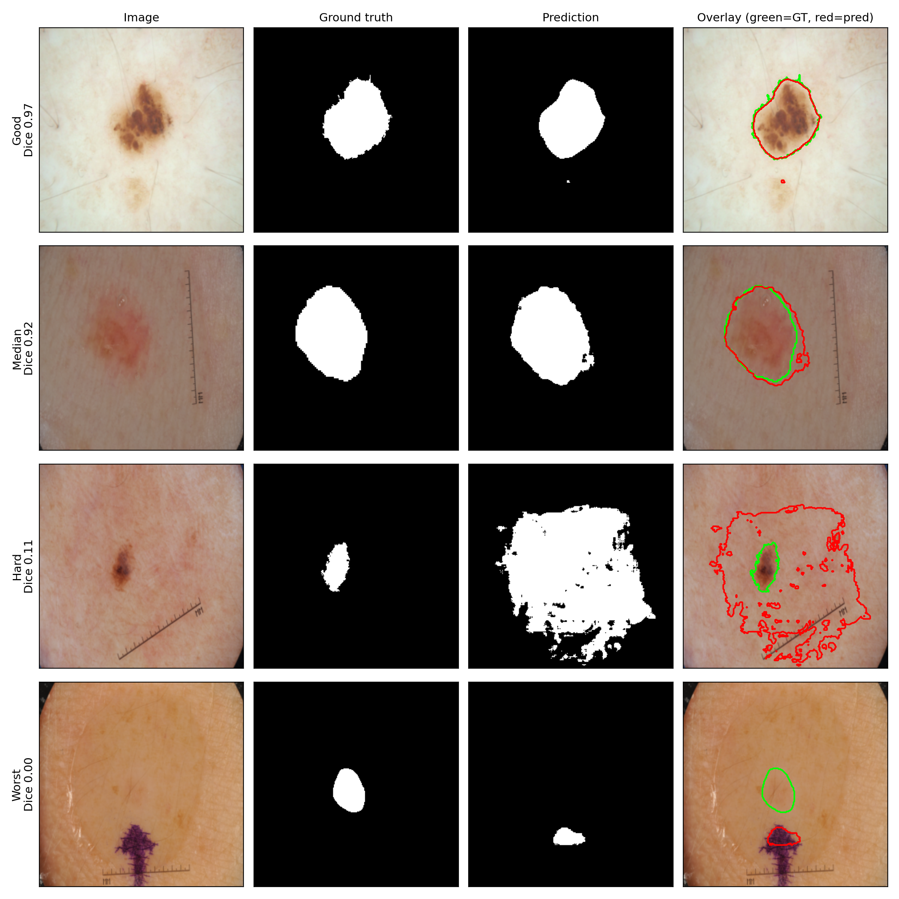
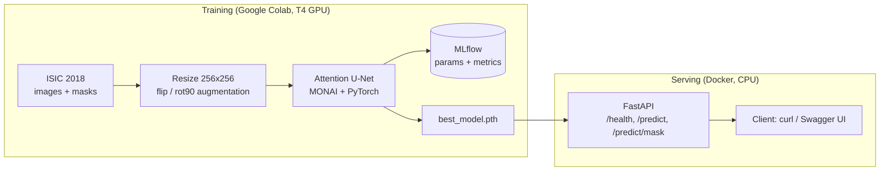
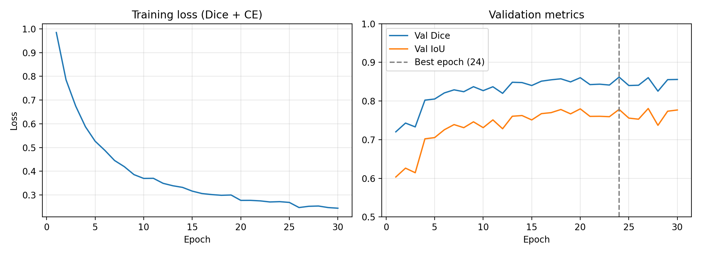
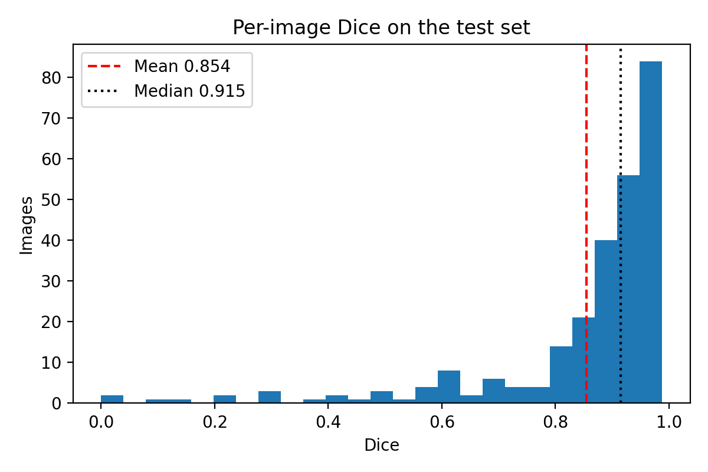
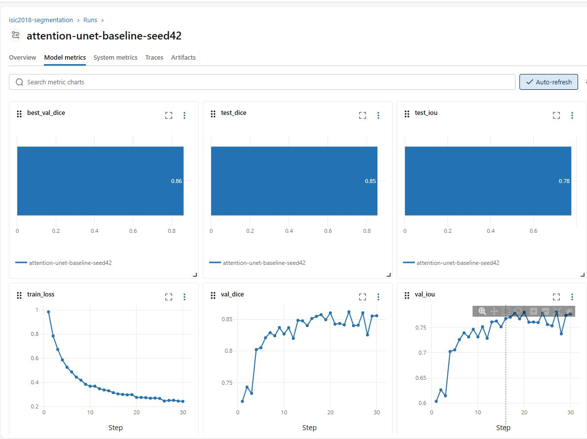
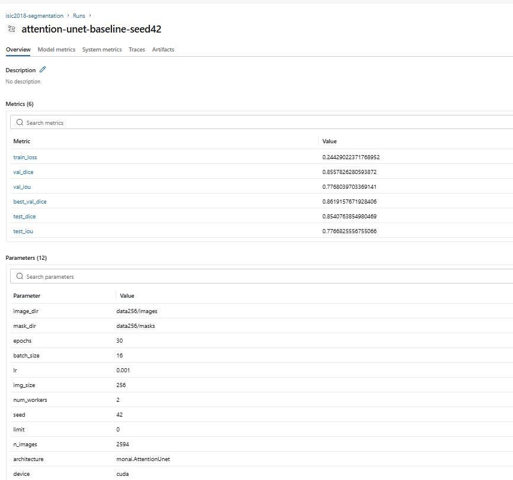
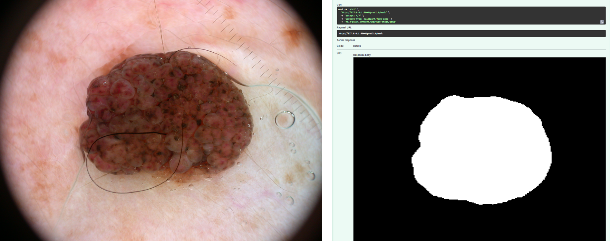

<h1 align="center">Skin Lesion Segmentation: An End-to-End MLOps Pipeline</h1>

<p align="center">
  
  
  
  
  
  
  
</p>

<p align="center">
  Attention U-Net (MONAI) trained on ISIC 2018 Task 1, with MLflow experiment tracking
  and a containerized FastAPI inference service.
</p>

<p align="center"><b>Test Dice 0.854 &nbsp;|&nbsp; Test IoU 0.777</b> (held-out split, see <a href="#results">Results</a>)</p>



> **Research prototype.** Not a medical device and not for clinical use.

## Contents
[Overview](#overview) · [Architecture](#architecture) · [Dataset](#dataset) · [Model and training](#model-and-training) · [Results](#results) · [Experiment tracking](#experiment-tracking) · [Quickstart](#quickstart) · [Project structure](#project-structure) · [Design decisions](#design-decisions) · [Limitations](#limitations-and-ethical-considerations) · [Future work](#future-work)

## Overview
This project tackles automated segmentation of skin lesions in dermoscopy images.
Rather than stopping at a notebook, it covers a complete, reproducible path from
data to a served model: tracked PyTorch/MONAI training, checkpoint selection on a
validation set, a single held-out test evaluation, and deployment as a
containerized REST API.

## Architecture


## Dataset
- **ISIC 2018 Task 1** (lesion boundary segmentation): 2,594 training images with masks
- **Split:** random 80/10/10 with seed 42, giving 2,075 train / 259 validation / 260 test
- The exact test file names are stored in [`docs/test_split.txt`](docs/test_split.txt).
- **Important:** the split is drawn from the ISIC 2018 *training* set, not the
  official test set, so results are **not directly comparable to leaderboard numbers**.
- **Citation:** Codella et al., "Skin Lesion Analysis Toward Melanoma Detection 2018:
  A Challenge Hosted by the International Skin Imaging Collaboration (ISIC)".
  The dataset has its own license and terms; see the ISIC archive. It is not
  included in this repository. Example images shown in this README are taken from
  the ISIC 2018 dataset.

## Model and training
| Item | Value |
|---|---|
| Architecture | MONAI `AttentionUnet` (2D), 5 levels, channels 16 to 256 |
| Input | RGB, resized to 256x256 |
| Loss | Dice + Cross-Entropy |
| Optimizer | Adam, learning rate 1e-3 |
| Epochs / batch size | 30 / 16 |
| Augmentation | random flips, random 90-degree rotations |
| Model selection | best validation Dice checkpoint (epoch 24) |
| Hardware | Google Colab T4 GPU |

The test set was used once, at the end, with the selected checkpoint.

## Results
| Split | Dice | IoU |
|---|---|---|
| Validation (best epoch, 24) | 0.862 | 0.778 |
| Test | 0.854 | 0.777 |



Validation Dice rose quickly during the first ten epochs and then fluctuated between
roughly 0.82 and 0.86, while training loss kept decreasing, so a longer schedule is
unlikely to help much. Checkpoint selection on a 259-image validation set is noisy.
The test score is slightly below the best validation score, which is expected
because the checkpoint was chosen for its validation performance.

<table>
  <tr>
    <td></td>
    <td>
      <b>Per-image Dice on the test set</b> (mean 0.854, median 0.915).<br><br>
      The distribution is strongly left-skewed: the typical image scores above 0.9,
      while a small tail of failures (some near zero) pulls the mean below the median.
      Aggregate Dice therefore hides a minority of difficult cases, which are
      examined below.
    </td>
  </tr>
</table>

### Qualitative results and failure cases
Examples are selected by Dice rank (90th percentile, median, third-worst, worst),
not hand-picked.

| Case | Dice | Observation |
|---|---|---|
| Good | 0.97 | Clear, high-contrast lesion; the boundary follows the annotation despite surrounding hairs. One tiny false-positive speck below the lesion. |
| Median | 0.92 | Faint, low-contrast lesion next to a ruler; the prediction is slightly larger than the annotation along the right and bottom edges. |
| Hard | 0.11 | Small dark lesion; the model labels a large ragged area of surrounding skin as lesion, so the score is dominated by false-positive area. |
| Worst | 0.00 | The model segments part of a purple skin-marker ink stroke, while the annotated lesion is a faint region above it; no overlap. |

Errors concentrate on low-contrast lesions and on images with artifacts such as
rulers and marker ink. These are visual observations on four examples, not a
systematic error analysis.

## Experiment tracking
Every run logs parameters and per-epoch metrics to MLflow (run name
`attention-unet-baseline-seed42`).
```bash
mlflow ui --backend-store-uri sqlite:///mlflow.db --port 5000
```



## Quickstart

**Run the API with Docker**
```bash
git clone https://github.com/shuaib17102/medical-vision-pipeline.git
cd medical-vision-pipeline
docker build -t isic-seg-api .
docker run --rm -p 8000:8000 isic-seg-api
```
Interactive docs: http://127.0.0.1:8000/docs

**Example request**
```bash
curl -X POST "http://127.0.0.1:8000/predict/mask" -F "file=@ISIC_0000104.jpg" --output mask.png
```


*Left: example input from ISIC 2018 (`ISIC_0000104.jpg`, not from the test split).
Right: response of `POST /predict/mask` from the running Docker container.*

**Endpoints**
| Method | Path | Returns |
|---|---|---|
| GET | `/health` | service and model status |
| POST | `/predict` | JSON with lesion area (%) and a base64 PNG mask |
| POST | `/predict/mask` | PNG mask |

**Reproduce training** (a GPU is strongly recommended)
```bash
pip install -r requirements.txt
# place the ISIC 2018 Task 1 data under data/ (see Dataset)
python train.py --epochs 30 --batch_size 16
python make_figures.py   # regenerates the figures in docs/
```
Seeds are fixed, but exact numbers may vary slightly across hardware and library versions.

## Project structure
```
.
├── app.py               # FastAPI service
├── model.py             # Attention U-Net definition and loader
├── train.py             # Training, evaluation and MLflow tracking
├── make_figures.py      # Generates the figures in docs/
├── Dockerfile
├── requirements.txt     # full environment (training + serving)
├── requirements-api.txt # lean dependencies for the Docker image
├── LICENSE
├── models/              # trained weights (best_model.pth, 7.7 MB)
└── docs/                # figures, screenshots and test_split.txt
```

## Design decisions
- **Standard MONAI architecture** rather than a custom one, to keep the focus on
  reproducibility, evaluation and deployment.
- **CPU-only PyTorch in the Docker image** to keep the image smaller; inference
  on a single image does not need a GPU.
- **Model loaded once at startup**, not per request, to avoid repeated load cost.
- **Fixed seeds, a fixed split and a saved test file list**, with test data used once.
- **Disclaimer in API responses** so outputs are not mistaken for clinical results.

## Limitations and ethical considerations
- Single dataset and single split; no external validation.
- Dermoscopy images only; behavior on other devices, skin tones or clinical
  photographs is unknown.
- Segmentation quality is not diagnosis, and there is no clinical validation.
- Trained from scratch with a short schedule and no hyperparameter search.
- The split depends on the exact file list. An earlier run used a slightly different
  file list that could not be reproduced, so the model was retrained with the test
  split saved to `docs/test_split.txt`.

## Future work
- Ablation against a plain U-Net to measure the effect of attention gates.
- External validation on a second dataset (e.g. PH2).
- Visual explainability (e.g. Grad-CAM-style overlays).
- Continuous integration with GitHub Actions and automated endpoint tests.

## Acknowledgements
[MONAI](https://monai.io), [PyTorch](https://pytorch.org), [MLflow](https://mlflow.org),
[FastAPI](https://fastapi.tiangolo.com), and the ISIC archive and challenge organizers.

## License
Code is released under the MIT License (see `LICENSE`). The ISIC dataset has its
own terms, and weights trained on it may inherit its restrictions; verify these
before reuse.